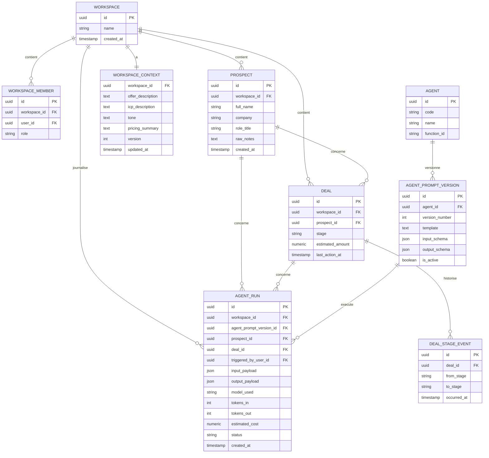

# Architecture des données

## Modèle de domaine (entités principales)

## Principes
- **IDs immuables** : `uuid` partout, jamais de clé métier (nom, email) comme clé technique.
- **`workspace_id` obligatoire** sur toutes les tables métier dès le premier jour (ADR-003), même sans RLS activé en V1.
- **Pas de résumé LLM comme source de vérité** (BR-7) : `AGENT_RUN.output_payload` est structuré (JSON conforme au `output_schema` de l'agent), pas un simple bloc de texte. Le texte libre reste disponible pour affichage/copie mais les champs exploitables (score, étape recommandée, etc.) sont extraits en champs typés.
- **Historique immuable** : `AGENT_RUN` et `DEAL_STAGE_EVENT` ne sont jamais mis à jour, seulement insérés — sert d'audit log (voir [[security-architecture]]).
- **Versionnement du contexte workspace** : `WORKSPACE_CONTEXT` versionné pour ne pas casser rétroactivement l'interprétation d'un `AGENT_RUN` passé si l'ICP change.

## Rétention
| Donnée | Propriétaire | Rétention par défaut | Justification |
|---|---|---|---|
| `PROSPECT`, `DEAL` | Workspace | Tant que le workspace existe | Donnée métier active |
| `AGENT_RUN` | Workspace | Minimum 12 mois (audit), configurable | Traçabilité des décisions, coûts |
| `WORKSPACE_CONTEXT` (versions passées) | Workspace | Conservé indéfiniment (léger volume) | Explique le comportement passé des agents |
| Logs techniques (latence, erreurs) | Système | 90 jours | Debug opérationnel, pas de valeur métier long terme |

## Ce que ce modèle ne couvre pas (volontairement)
Pas de table `Company` enrichie automatiquement (pas de scraping/enrichissement automatique, cf. FR "hors périmètre V1") — `PROSPECT.raw_notes` et `company` restent des champs saisis/collés par l'utilisateur.
