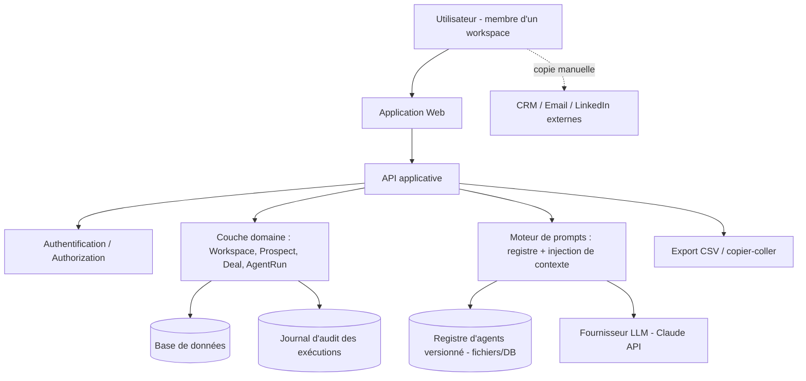
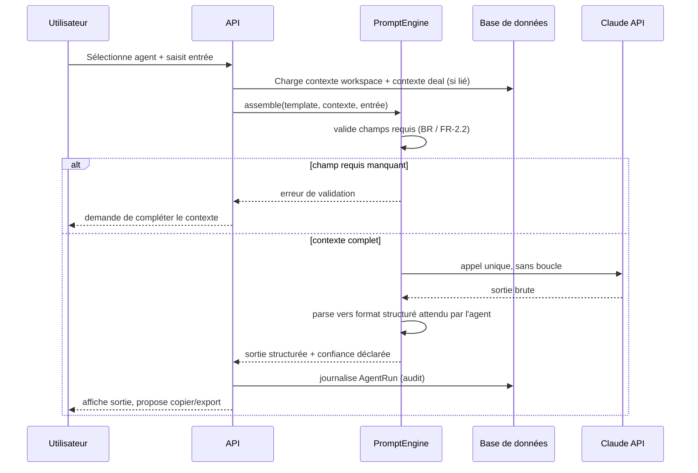

# Vue d'ensemble système

## Cadrage
Copilote semi-assisté, multi-workspace, sans agents autonomes ni intégrations externes réelles en V1 (voir [[assumptions]] A-002 à A-004). Le système est un **CRUD applicatif classique** (workspaces, prospects, deals, historique) enrichi d'une **couche de génération LLM synchrone, déclenchée par l'utilisateur, sans état persistant côté modèle**.

## Diagramme de contexte

Points clés :
- Aucune flèche automatique vers `ExternalTools` : toute sortie franchit la frontière du système par une action humaine (copier, exporter), jamais par un appel API sortant du système vers un tiers de communication.
- `PromptEngine` n'est pas un orchestrateur multi-agents : c'est une fonction déterministe (assemble contexte workspace + contexte deal + entrée utilisateur + template versionné → un seul appel LLM → sortie structurée validée).

## Flux d'exécution d'un agent (séquence)

## Classes de composants
| Composant | Nature | Pourquoi pas un agent autonome |
|---|---|---|
| Recommandation d'agents (BR-5, FR-5) | Code déterministe (table de règles) | Mapping symptôme → agents fixe, pas de raisonnement nécessaire |
| Validation des champs requis (FR-2.2) | Code déterministe | Règle de complétude, pas de jugement |
| Génération de sortie d'agent | 1 appel LLM synchrone | Cœur de valeur : rédaction/raisonnement qualitatif |
| Enchaînement de contexte (FR-4) | Code déterministe (pré-remplissage UI) | Récupération de données, pas de décision |
| Historique / audit | Code déterministe + stockage | Doit être fiable à 100%, jamais probabiliste |

Voir ADR-002 dans [[architecture-decisions]] pour la justification complète du choix "pas d'agents autonomes".
